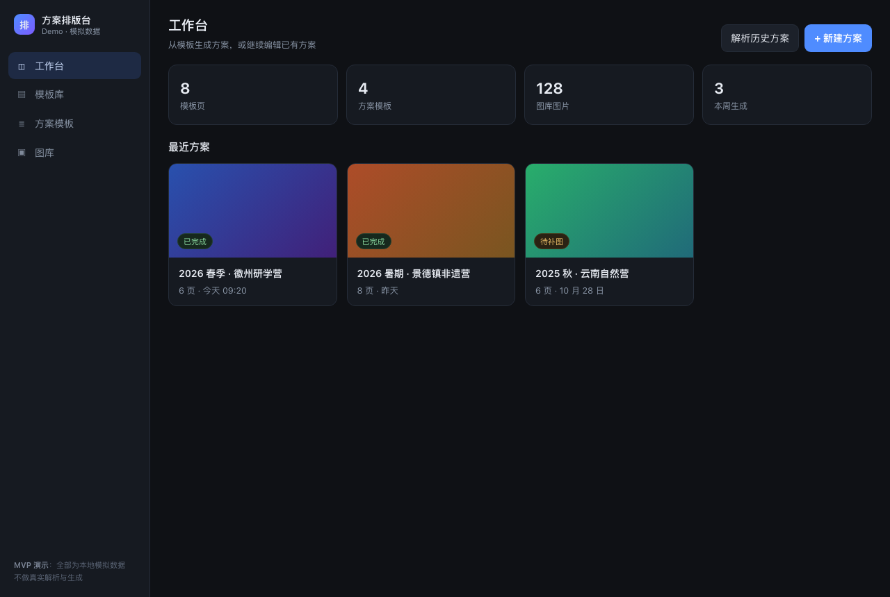

# ppt模板化排版

PPT 模板化排版工程：模板资源、排版脚本与导出产物的统一版本管理仓库。

## 目录约定

| 路径 | 用途 |
| --- | --- |
| `docs/` | 产品设计文档（PRD）与方案记录 |
| `demo/` | 可交互的前端 Demo（模拟数据，无后端） |
| `templates/` | `.pptx` / `.potx` 母版与版式模板 |
| `assets/` | 图片、字体、图标等静态资源 |
| `scripts/` | 排版、批量导出、校验脚本 |
| `tests/` | 仓库校验与 Demo 逻辑测试 |
| `output/` | 生成结果（已在 `.gitignore` 中忽略） |

## Demo（界面与流程原型）

单文件、零依赖、无后端：直接双击 `demo/index.html`，或在地址后加深链：

```text
demo/index.html#library     # 模板库
demo/index.html#decks       # 方案模板编辑
demo/index.html#gallery     # 图库
demo/index.html#wizard      # 新建方案向导（第 2 步）
demo/index.html#wizard-md   # 向导第 2 步，已解析示例 Markdown
demo/index.html#preview     # 生成结果预览（#preview-2 跳到第 2 页）
```

演示路径：工作台 →「+ 新建方案」→ 选模板 → 上传 Markdown 文案 → 配图生成 → 预览调字段/换图。
所有解析与生成均为模拟动画，数据写死在脚本里，不发任何网络请求（Markdown 解析在浏览器本地完成）。

**方案模板编辑器**（`#decks`）是三列结构：方案模板列表 → 板块列表 → 页面，
三列都支持新建、删除、上移下移与保存。板块＝封面 / 行程亮点 / 研学行程汇总 / 关键数据 / 报名须知。

**文案输入**（`#wizard`）不再逐页手填：选好方案模板后，系统按板块生成标准 Markdown 骨架，
可下载 `.md`、填写后上传，解析结果按板块回填并标出缺失字段。示例见
[samples/徽州研学营-文案示例.md](samples/徽州研学营-文案示例.md)。



## 分支策略

- `main`：可发布状态，始终保持可导出。
- `feat/*`：单个版式或脚本改动。
- `fix/*`：缺陷修复。

提交信息采用 `type(scope): summary`，例如 `feat(layout): 增加三栏图文版式`。

## 远端配置

```text
origin  https://github.com/hl54hlhl2008/ppt-template-layout.git
```

本地仓库已初始化（`main`）并推送到远端，`origin/main` 与本地 HEAD 一致，已建立跟踪关系。
新的 clone 用：

```bash
git clone https://github.com/hl54hlhl2008/ppt-template-layout.git
```

日常提交后 `git push` 即可。若从新机器推送，先确认凭据可用：

```bash
git config --get credential.helper     # macOS 默认 osxkeychain
ssh -T git@github.com                  # 或走 SSH
```

## 排错记录

环境实测结论（详见下表）：网络到 GitHub 正常，历史问题集中在**认证与权限**。

| 现象 | 原因 | 处理 |
| --- | --- | --- |
| `remote: Repository not found.` | 远端仓库尚未创建 | 在网页创建空仓库（不要勾初始化文件） |
| `fatal: failed to get: 100001` + `could not read Username` | macOS 钥匙串条目需人工确认，非交互 shell 读不到 token | 在终端里手动 `git push`，弹窗选"始终允许"；或改用 PAT |
| `Permission denied (publickey)` | `~/.ssh/id_ed25519.pub` 未添加到 GitHub | 粘贴公钥到 Settings → SSH keys |
| `Host key verification failed` | `github.com` 不在 `known_hosts` 且当前会话无法写入 `~/.ssh` | 在终端执行一次 `ssh -T git@github.com` 接受指纹 |
| API 创建仓库返回 `403 Resource not accessible by personal access token` | 已存的 PAT 无仓库创建权限 | 网页创建仓库，或给 PAT 勾选 Administration 写权限 |
| `src refspec # does not match any` | 把行内 `#` 注释一起粘进了 zsh；交互式 zsh 默认不解析 `#` | 命令与注释分行，或执行 `setopt interactive_comments` |
| `Permission to <user>/<repo>.git denied to <user>` + `403` | 细粒度 PAT 只有该仓库的 Contents 只读权限 | 编辑 token：Repository access 选中该仓库，Permissions → Contents → Read and write |
| `Failed to connect to github.com port 443`（api 正常） | 当前解析到的 github.com IP 不可达 | 换解析 IP 推送：`git -c http.curloptResolve=github.com:443:140.82.112.3 push origin main` |

### 用 PAT 推送（绕过钥匙串）

```bash
export GH_TOKEN=<PAT，需 repo 权限>
REPO_NAME=ppt-template-layout ./scripts/create-github-repo.sh
```

脚本用一次性 `Authorization` 头推送，不会把 token 写进 `.git/config`。

## 日常操作

```bash
git status                 # 查看改动
git add -A && git commit -m "feat(layout): 说明"
git push                   # 推送到 origin/main
git pull --rebase          # 拉取并变基，保持线性历史
```

## 大文件说明

`.pptx` 等二进制模板会随历史增长。单个文件超过 50 MB 时改用 Git LFS：

```bash
git lfs install
git lfs track "*.pptx"
git add .gitattributes && git commit -m "chore: 启用 Git LFS 管理 pptx"
```
